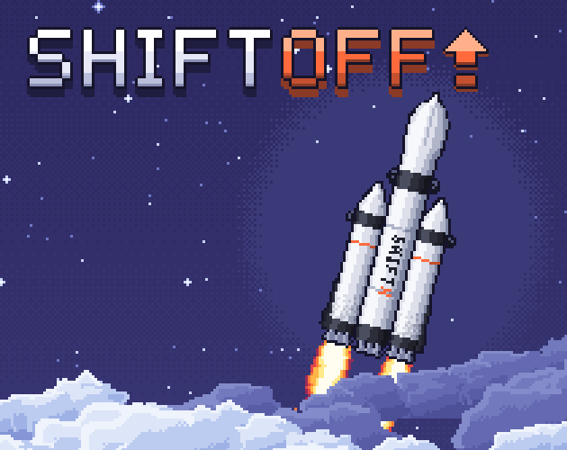

# ShiftOff!



You're the astronaut on ShiftX's revolutionary new rocket, bound for Mars. To save money, it's been stripped down to the bare minimum it needs for the mission: the Shift keys.

**Play it on itch.io: [arkytex.itch.io/shiftx](https://arkytex.itch.io/shiftx)**

## How to play

| Input | Does |
|---|---|
| Left Shift | Fires the left booster |
| Right Shift | Fires the right booster |
| Both | Climb |

Fire one booster and the rocket leans the other way. Lean too far, or spin too fast, and it breaks up. Dodge the birds, drones, planes, storm clouds and space rocks on the way up, then read what the internet thinks of your crash on Shiftter.

On phones and tablets, two Shift buttons appear in the bottom corners. On the game over screen, Enter, Space or both Shifts start another run, and Esc goes back to the menu.

## Running it locally

Needs [Node.js](https://nodejs.org) 24 and [pnpm](https://pnpm.io) 11.

```bash
pnpm install
pnpm run dev-nolog     # dev server at http://localhost:8080
pnpm run build-nolog   # production build in dist/
```

Add `?touch=1` to the URL to get the phone controls on a desktop, or `?touch=0` to hide them on a phone.

`dev` and `build` without `-nolog` also run `log.js`, a leftover from the Phaser template that sends the template name and Phaser version to Phaser Studio. Use the `-nolog` versions to skip it.

## Releases

Every push to `main` builds the game, tags a new version and publishes it to [GitHub Releases](https://github.com/arkytex/shiftx/releases) and itch.io (`.github/workflows/release.yml`). The version comes from the commit messages since the last tag:

| Commit | Bump |
|---|---|
| `feat!:` or `BREAKING CHANGE` | major |
| `feat:` | minor |
| anything else | patch |

Pushes that only touch docs or Markdown don't release, and neither does a commit with `[skip release]` in its message. The itch.io upload needs a `BUTLER_API_KEY` repository secret.

## Project layout

| Path | What's in it |
|---|---|
| `src/game/scenes/` | Boot, Preloader, MainMenu, Game, GameOver |
| `src/game/scenes/Game.js` | The physics: thrust, torque, topple and the break-up meter |
| `src/game/posts.js` | The 500 Shiftter posts and how one gets picked |
| `src/game/Obstacles.js` | What spawns where, and how each obstacle moves |
| `src/game/Hud.js`, `TouchControls.js` | In-game HUD and phone buttons |
| `public/assets/` | Pixel art, fonts and their manifests |
| `docs/style_guide.md` | How the art is drawn, sized and packed |

Built with [Phaser 4](https://phaser.io) and [Vite](https://vitejs.dev).

## License

MIT, see [LICENSE](LICENSE).
